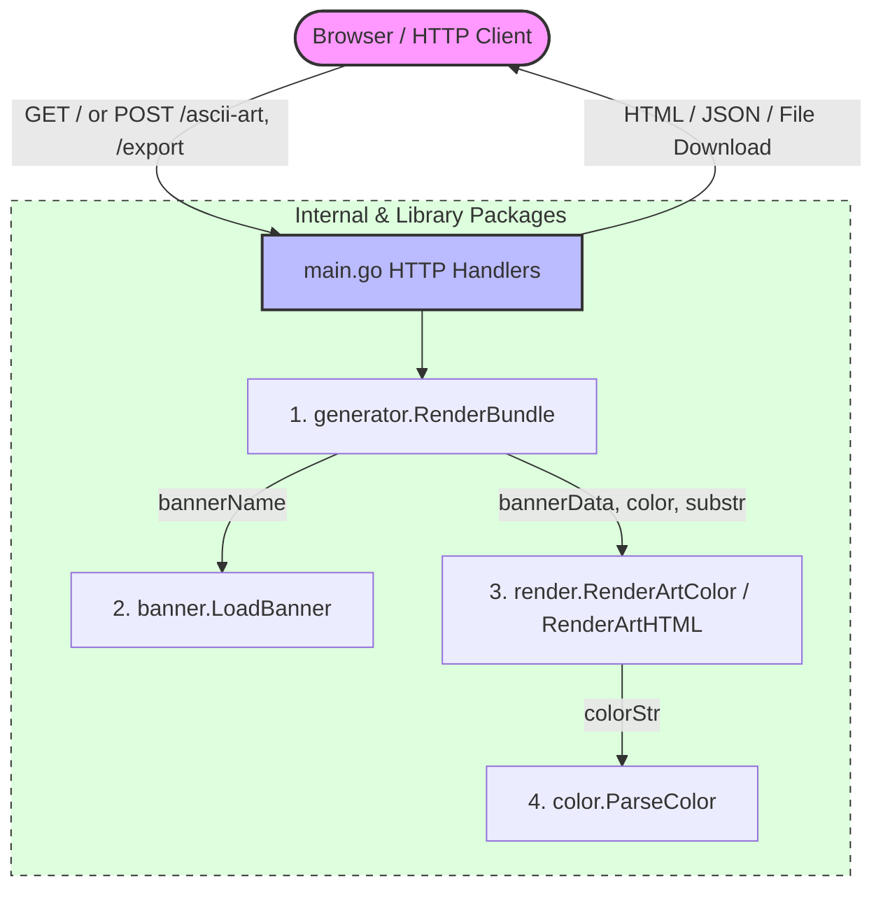

# Architecture Document

## ASCII-Art-Web Generator - Modular Design

### 1. System Overview

ASCII-Art-Web is an HTTP web application and Go library that transforms text strings into ASCII art using predefined banner templates (`standard`, `shadow`, `thinkertoy`) and optional color/substring styling. The system follows a modular pipeline architecture with clear separation of concerns: HTTP & API Request Handling, Shared Generation Orchestration, Input Parsing, Banner Loading, Color Handling, and Plain/HTML Art Rendering.

### 2. Architectural Principles

- **Modularity:** Business logic isolated in testable `internal/` packages and exposed via `asciiart/`
- **Testability:** Comprehensive unit and HTTP handler tests across all packages
- **Determinism:** Same input always produces the exact same output
- **Isolation:** Zero external dependencies — Go standard library only
- **Fail-Fast & Security:** Early input validation (ASCII 32–126, 1000-char limit), banner whitelisting, and HTML escaping

### 3. High-Level Architecture



### 4. Component Design

#### 4.1 HTTP Server & Entry Point (`main.go`)

**Package:** `main`  
**Responsibility:** HTTP routing, request validation, content negotiation (HTML vs. JSON), and file exports.

**Endpoints:**

1. `GET /` (`homeHandler`): Renders `templates/index.html`
2. `POST /ascii-art` (`asciiArtHandler`): Validates form input (`text`, `banner`, `color`, `substr`), invokes `generator.RenderBundle`, and responds with either HTML or JSON (`Accept: application/json`)
3. `POST /export` (`exportHandler`): Exports rendered ASCII art as downloadable `.txt`, `.html`, or `.json` files with `Content-Type`, `Content-Disposition`, and `Content-Length` headers

#### 4.2 Generator Orchestrator (`internal/generator/generator.go`)

**Package:** `generator`  
**Signatures:**
- `func RenderString(input string, opts Options) (string, error)`
- `func RenderStringHTML(input string, opts Options) (string, error)`
- `func RenderBundle(input string, opts Options) (string, string, error)`

**Responsibility:** Coordinate banner loading and render both plain text and HTML-formatted ASCII art from a single banner read.

#### 4.3 ParseInput Function (`internal/parser/parse_input.go`)

**Package:** `parser`  
**Signature:** `func ParseInput() (ParseResult, error)`

**Responsibility:** Validate and process CLI-style arguments (`--color=`, optional substring, input text, and banner), replacing literal `\n` sequences with actual newlines.

#### 4.4 LoadBanner Function (`internal/banner/load_banner.go`)

**Package:** `banner`  
**Signature:** `func LoadBanner(path string) ([]string, error)`

**Responsibility:** Load and normalize banner files (`\r\n` to `\n`) into a slice of lines.

#### 4.5 Color Parser (`internal/color/color.go`)

**Package:** `color`  
**Signature:** `func ParseColor(colorStr string) (Color, error)`

**Responsibility:** Parse named ANSI/CSS colors, hex (`#RRGGBB`), `rgb(r, g, b)`, and `hsl(h, s%, l%)` into terminal ANSI escape sequences.

#### 4.6 Render Functions (`internal/render/render_art.go`)

**Package:** `render`  
**Signatures:**
- `func RenderArtColor(w io.Writer, input string, banner []string, colorStr string, colorSubstr string)`
- `func RenderArtHTML(w io.Writer, input string, banner []string, colorStr string, colorSubstr string)`

**Responsibility:** Convert text to 8-row ASCII art blocks and optionally apply ANSI color codes or HTML `<span style="color:...">` wrappers with full HTML entity escaping.

#### 4.7 Public Library API (`asciiart/asciiart.go`)

**Package:** `asciiart`  
**Signatures:**
- `func RenderString(input string, opts Options) (string, error)`
- `func RenderStringHTML(input string, opts Options) (string, error)`
- `func RenderBundle(input string, opts Options) (string, string, error)`

**Responsibility:** Provide an importable public API for rendering plain and HTML ASCII art strings.

### 5. File Structure

```
ascii-art-web/
├── asciiart/                # Public library package
│   └── asciiart.go
├── banners/                 # Banner templates (standard, shadow, thinkertoy)
│   ├── shadow.txt
│   ├── standard.txt
│   └── thinkertoy.txt
├── internal/                # Internal packages
│   ├── banner/
│   ├── color/
│   ├── generator/
│   ├── parser/
│   └── render/
├── static/                  # Frontend CSS and JavaScript assets
│   ├── app.js
│   ├── layout.css
│   └── style.css
├── templates/               # HTML templates
│   └── index.html
├── docs/                    # Architecture and test specifications
│   ├── architecture.MD
│   └── golden_tests.md
├── Dockerfile               # Multi-stage Docker build
├── docker.sh                # Docker helper script
├── main.go                  # HTTP server entry point
├── main_test.go             # HTTP handler unit tests
├── go.mod                   # Module definition
└── README.md                # Project documentation
```

### 6. Banner File Format

- 1 empty line separator at start
- 9 lines per character (8 art lines + 1 separator)
- ASCII range 32–126 supported (95 printable characters)
- Index formula: `(ASCII_code - 32) * 9 + 1 + row`

### 7. Testing Strategy

- **Unit & Handler Tests:** `go test -v ./...`
- **Static Analysis:** `go vet ./...`
- **Golden Tests:** 30 comprehensive core rendering cases plus color extension tests in [`docs/golden_tests.md`](golden_tests.md).

